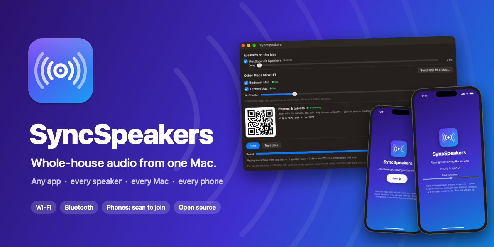
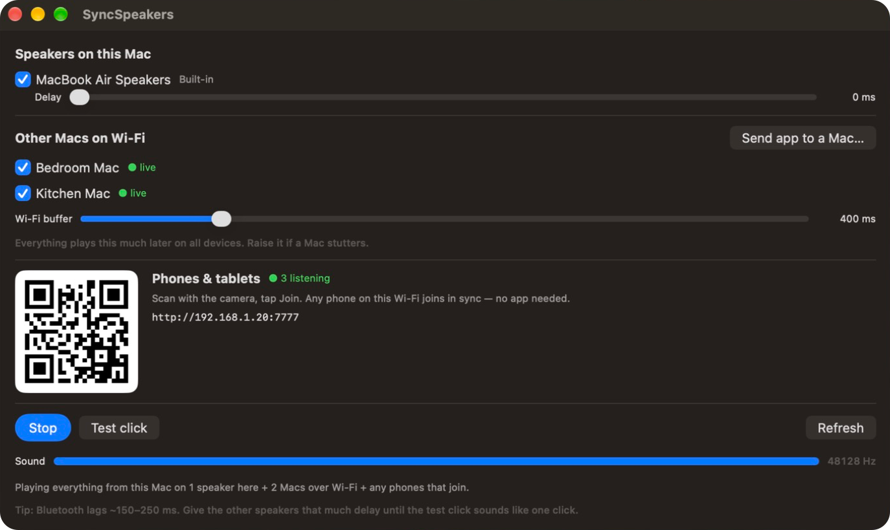
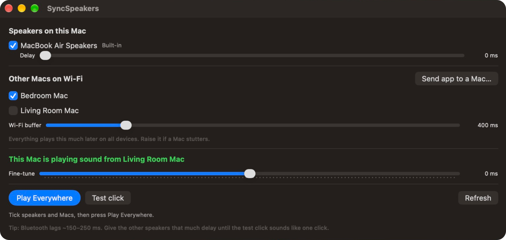

<p align="center">
  
</p>

<p align="center">
  Whatever your Mac plays — any app — comes out of every speaker, every Mac and every phone in the house at the same moment.
</p>

<p align="center">
  <a href="https://github.com/thevenice/SyncSpeakers/releases/latest"><b>Download for Mac</b></a>
</p>

<p align="center">
  <a href="LICENSE"></a>
  
  
</p>

---

## What it does

Pick one Mac as the **source**. SyncSpeakers captures everything it plays — Spotify, YouTube in a
browser, Apple Music, VLC, games — and plays it, in sync, on:

- **This Mac's speakers**: built-in, Bluetooth, USB, HDMI/DisplayPort. Tick as many as you like.
- **Other Macs on the same Wi-Fi**: any Mac with SyncSpeakers open shows up automatically.
- **iPhones, Android phones and tablets**: scan the QR code, tap **Join**, done. No app to install.

Think of it as a DIY multi-room / home-theatre system made from the Macs and speakers you already have.
No accounts, no cloud, no extra hardware. One small native app, about 1,200 lines of Swift.

## Screenshots

**The source Mac** — pick local speakers and other Macs, then press Play Everywhere:

<p align="center">
  
</p>

**A receiving Mac** — just leave the app open; it plays whatever the source sends and lets you fine-tune its timing:

<p align="center">
  
</p>

## Features

- System-wide capture of all apps (no per-app setup, no virtual audio driver to install)
- Multi-output to several local speakers at once, with drift correction
- Per-speaker delay to line Bluetooth up with wired speakers
- Wi-Fi streaming to other Macs with automatic discovery (Bonjour) and reconnects
- Clock sync between Macs, so every device plays each sound at the same instant
- Adjustable Wi-Fi buffer, plus a fine-tune slider on each receiving Mac
- **Test click** button to check alignment by ear
- **Scan & join:** phones join the swarm from a QR code and play in their browser, in sync
- AirDrop the app to another Mac straight from the window
- Restores your normal sound output when you stop or quit

## Requirements

- macOS 14.4 or later (uses Core Audio process taps)
- Apple Silicon Mac (the build script targets `arm64`; Intel builds need a one-word change)
- Xcode Command Line Tools (`xcode-select --install`) — full Xcode is not needed
- All Macs on the same Wi-Fi network

## Install

**Download:** grab `SyncSpeakers-…-macOS-arm64.zip` from the
[latest release](https://github.com/thevenice/SyncSpeakers/releases/latest), unzip it, move the app to
Applications, then right-click → **Open** the first time.

**Or build it yourself:**

```bash
git clone https://github.com/thevenice/SyncSpeakers.git
cd SyncSpeakers
./build.sh
open SyncSpeakers.app
```

`build.sh` compiles the app with `swiftc`, adds the icon and Info.plist, ad-hoc signs it, and also
writes `SyncSpeakers.zip` for copying to your other Macs.

Because the app is ad-hoc signed (not notarized), the first time you open a copied app on another Mac,
**right-click → Open**, or allow it under **System Settings › Privacy & Security**.

## Use

**On the source Mac** (the one playing music):

1. Tick the speakers you want under **Speakers on this Mac**.
2. Tick the Macs you want under **Other Macs on Wi-Fi**.
3. Press **Play Everywhere** and play anything.

**On every other Mac**: just open SyncSpeakers and leave it running. It receives automatically and shows
*"This Mac is playing sound from …"*.

**On phones and tablets** (iPhone, iPad, Android): while the source Mac is playing, its window shows a
QR code. Scan it with the camera, tap **Join 🔊**, and the phone plays along. Keep the page open with the
screen on: browsers stop sound when the phone locks. Each phone has its own **Fine-tune** slider.

**Getting it tight**

| Problem | Fix |
| --- | --- |
| A Bluetooth speaker lags | Give the *other* local speakers 150–250 ms of **Delay** until **Test click** sounds like one click |
| Another Mac is early or late | Move **Fine-tune** on that Mac |
| A Mac or phone stutters or drops out | Raise the **Wi-Fi buffer** |
| A phone is early or late | Move **Fine-tune** on the phone's page |
| Video lip-sync feels off | Lower the **Wi-Fi buffer** (everything plays that much later) |

### Permissions

macOS asks once for each:

- **Screen & System Audio Recording** — to capture what your Mac plays
- **Local Network** — to find and stream to your other Macs and phones

## How it works

```
                       ┌───────────────────── source Mac ──────────────────────┐
 any app ─► Core Audio │ process tap (mutes apps) ─► ring buffer ─► multi-output│─► built-in + Bluetooth + USB
                       │                     │                                  │
                       │                     └─► TCP stream (16-bit PCM + time) │
                       └─────────────────────────────────┬──────────────────────┘
                                                         │ Wi-Fi (Bonjour _syncspk._tcp)
                              ┌──────────────────────────┴───────────────────────────┐
               ┌──────────────▼─────────────┐                  ┌─────────────────────▼──────┐
               │ other Mac: clock sync ─►   │─► its speakers   │ phone browser (QR → :7777) │─► phone speaker
               │ ring buffer ─► output      │                  │ WebSocket ─► Web Audio     │
               └────────────────────────────┘                  └────────────────────────────┘
```

- **Capture.** A global Core Audio *process tap* (`CATapDescription`) records the mix of every app except
  SyncSpeakers itself, and mutes the original so you only hear the synced copy.
- **One timeline.** Each block of audio is numbered and stamped with the source Mac's clock. Every device
  plays sample *N* at `capture time + buffer`, measured on the source's clock.
- **Clock sync.** Receivers ping the source four times a second and keep the clock offset from the fastest
  round trip (NTP-style), so network jitter doesn't move the timing.
- **Playback.** A HAL output unit pulls from a ring buffer. If playback drifts more than 0.25 ms from where it
  should be, it nudges by a single sample; big jumps resync instantly.
- **Phones.** The source Mac also runs a tiny web server on port 7777. The QR code opens a page that
  receives the same stream over a WebSocket, syncs to the Mac's clock the same way, and schedules each
  chunk with Web Audio at the exact moment it should play.
- **Local speakers.** Several devices are grouped into one stacked aggregate device with drift
  compensation. Per-speaker delay uses the sub-device extra-latency setting.

### Wire format

TCP, each message `[type: u8][length: u32 LE][payload]`:

| Type | Payload |
| --- | --- |
| `1` format | sample rate `f64`, buffer `i64` ns, then the source Mac's name (UTF-8) |
| `2` audio | first frame index `i64`, capture time `i64` ns, interleaved stereo `i16` |
| `3` ping | sender time `i64` ns (receiver → source) |
| `4` pong | echoed time `i64`, source time `i64` ns |

Phones get the same messages as WebSocket binary frames (`[type][payload]`, no length prefix), with the
ping time as `f64` milliseconds and an extra `5` *stopped* message.

## Project layout

```
Sources/main.swift   SwiftUI window and the Router that wires everything together
Sources/Audio.swift  Core Audio helpers, system-audio capture, time-aligned player
Sources/Net.swift    Bonjour discovery, streaming sender, receiver with clock sync
Sources/Web.swift    web server + WebSocket for phones, and the phone page itself
tools/make-icon.swift  draws assets/icon.png
tools/make-art.swift   trims screenshots and draws assets/banner.png
build.sh             builds SyncSpeakers.app and SyncSpeakers.zip
```

## Limitations

- The source must be a Mac: iOS doesn't let apps capture other apps' sound.
- Phones play only while the page is open and the screen is on (no background playback in the browser).
- Smart TVs and HomePods can't receive the stream yet (a TV with a browser may work, untested).
- Everything is delayed by the Wi-Fi buffer (400 ms by default), which matters for video.
- Audio is sent uncompressed (~1.5 Mbit/s per receiving Mac or phone). Fine on home Wi-Fi; a phone hotspot may need
  a bigger buffer.
- Bluetooth speakers add their own latency, which you line up by ear with the delay sliders.

## Contributing

Issues and pull requests are welcome. Ideas that would make a big difference:

- Native iOS / Android receivers that keep playing with the screen locked
- Opus compression for weak Wi-Fi
- Automatic Bluetooth latency calibration using the microphone
- A menu-bar-only mode and launch at login

## License

[MIT](LICENSE)
